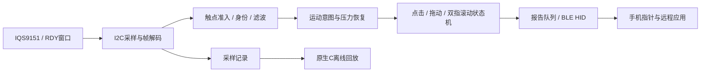

# BackPad

**BackPad 是一块固定在手机背面的磁吸触控板。横屏握持时，手指在背面操作远程电脑。**

触控操作接近常见触控板的用法。单指滑动移动光标，单击选择，双击打开，按住拖动可以选取文字或移动对象，双指滑动可以滚动页面。团队已用安卓手机、UU 远程和 Windows 联调。正在开发 **24 键单手输入键盘**，目标是在横屏远程操作时减少指针操作与输入之间的切换。

- [参赛技术方案、硬件架构和研发进展](docs/TECHNICAL-SOLUTION.md)
- [1 mm PLA 验证摘要](validation/pla-continuity-20261118.json) · [CUDA 逐组实验数据](validation/pressure-sweep-20261118.json)
- [工程案例](docs/ENGINEERING.md) · [运行公开回放](docs/REPRODUCE.md) · [当前触点策略](firmware/app/src/bp_touch_policy.c)

## 当前原型与固件

2026 年 11 月 18 日，IQS9151 / nRF52840 双板原型使用 **1 mm PLA** 盖板做了指尖短划、指腹短划和原地轻点测试。当前固件分别处理弱触重新落指、面积为 3 时有明确方向的移动，以及单指已经接纳后因信号下降而冻结的问题。两段典型冻结误点在同输入回放中各由 **0 移动、1 次按下**变为 **15 条移动报告、0 次按下**。原地轻点回放保持零移动，历史双击、拖动、滚轮和抬手用例通过回归。最新版本已烧录并读回核验，其他冻结片段和新版实机手感仍待复测。见[验证摘要](validation/pla-continuity-20261118.json)。

2026 年 10 月，BackPad 获 WTCC 创客松第一名，个人参赛。比赛作品来自 10 月阶段的原型。最新原型照片和实拍演示收录在参赛材料中。

## 无硬件也能复现什么

需要Python 3.10+、C11编译器；Windows下使用MSVC x64 Build Tools。不需要Nordic SDK、Python第三方包、账户或硬件。

```sh
python tools/reproduce.py --out .build/replay
```

脚本编译历史源码并生成报告。以下为 2026-11-16 在 Windows/MSVC 19.44.35225 的历史 R2 工程对照。

| 固定输入 / 检查 | v0.20.15 | pressure R1 | pressure R2 |
|---|---:|---:|---:|
| 真实失败片段：目标区间移动报告数 | 0 | 16 | 16 |
| 同片段：按下报告数 | 1 | 0 | 0 |
| 18项合成停止/压力尾迹检查：相对v15新增尾移 >1 HID count的用例数 | 基准 | 6 | 0 |

这是固定样本的行为对照，**不是整体准确率、端到端延迟或实机舒适度指标**。18项为合成反例；真实失败片段与历史17组回归是不同输入集合。原始与脱敏输入/入口适配前后，v15全部411个、R2全部419个HID事件经时间平移后逐项一致。[执行摘要](validation/local-20261116.json)

## 系统结构



[架构与接口](docs/ARCHITECTURE.md)说明传感器、策略层和手势核心的职责。[源码映射](SOURCE.json)记录历史 R2 源码与公开快照的关系。

## 代码导航

| 内容 | 入口 |
|---|---|
| 主循环、连接与BLE发送 | [main.c](firmware/app/src/main.c) |
| RDY/I2C、帧解码 | [sensor9151](firmware/sensor9151/src/bp_iqs9151_zephyr.c)、[解码器](firmware/sensor9151/src/bp_iqs9151.c) |
| 触点准入、压力连续性、恢复位置 | [bp_touch_policy.c](firmware/app/src/bp_touch_policy.c) |
| 点击、拖动、滚动、报告排队 | [bp_pointer.c](firmware/app/vendor/v5/src/bp_pointer.c) |
| HID报告、异步发送通道 | [bp_hid.c](firmware/app/vendor/v5/src/bp_hid.c)、[bp_channel.c](firmware/app/vendor/v5/src/bp_channel.c) |
| 目标板与构建配置 | [backpad.dts](firmware/app/boards/backpad/backpad.dts)、[prj.conf](firmware/app/prj.conf) |
| 历史反例、恢复补丁、输入 | [samples](samples/pressure-drop/metadata.json)、[历史差异清单](samples/variants/manifest.json) |

`app/vendor/v5`是工程历史中的内部核心目录名称，不表示这里打包了Nordic SDK。

## 验证状态

| 层级 | 已知结果 |
|---|---|
| 最新原型 | 三组 30 秒实采用于 1 mm PLA 回放对照。新版固件 412,148 字节烧录后逐字节读回一致，触控帧读取正常，BLE HID 已连接。 |
| 公开复现 | v15/R1/R2 固定输入对照、18 项合成尾迹、脱敏与入口等价性，以及 CUDA 离线强度扰动实验。 |
| 待复测 | 新版固件的指尖短划、指腹短划和轻点体验，以及不同手机及远程软件的兼容性。 |

完整固件的构建需要外置 Azoteq 生成设置文件。适用条件见[构建说明](docs/REPRODUCE.md#完整固件构建)与[许可说明](THIRD_PARTY.md)。

## 贡献与研发方式

王宝晨（Austin）负责使用场景、交互目标与约束、方案采纳与否决、软硬件联调、实物反馈和交付判断。AI协作承担代码实现、审阅、回放工具与执行；具体问题通过源码、输入和结果回查，而非以AI“已完成”总结作为验收。

例如，维护者在实测中否定v0.20.15离线改善等于手感改善，要求延长并分开采样快划/微调；后续根据轨迹诊断采用压力连续性修复，再用停止反例收紧R1条件。不能把本人采纳的技术建议写成本人独立原创，也不把外部工程合作、厂商设置和开源组件计为独立设计。

## 许可与版本

本仓库所选项目软件、配套文档和回放样本由维护者确认授权，采用 [MIT License](LICENSE)。此授权不改变外部依赖的许可，也不涵盖未收录的厂商设置及其派生表、SDK、原理图/PCB/模型或其他素材。[范围与第三方说明](THIRD_PARTY.md)

> English overview: BackPad is a magnetic rear-mounted phone touchpad for remote-computer workflows. This engineering snapshot includes the C touch pipeline, a sanitized real sensor capture, historical counterexamples, and a hardware-free replay. It is a prototype snapshot, not a production-ready hardware release. The included project software, documentation and replay samples are MIT-licensed; third-party SDKs and vendor-generated settings are not redistributed.
