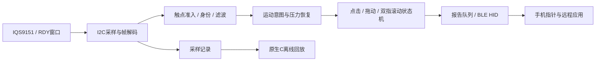

# BackPad

**固定在手机背面的磁吸触控硬件，让通过手机操作远程电脑或 Agent 时的指针移动、点击、选取、拖动与滚动更方便。**

这里展示 BackPad 的触控固件与可复现工程案例：同一段真实输入如何暴露运动中断，修复为何又带来抬手尾迹，以及怎样用反例收紧恢复条件。

- **先看结果：** [关键问题与取舍](docs/ENGINEERING.md) · [运行回放](docs/REPRODUCE.md)
- **实现入口：** [触点策略](firmware/app/src/bp_touch_policy.c) · [手势与指针核心](firmware/app/vendor/v5/src/bp_pointer.c)
- **当前版本：** IQS9151 / nRF52840 双板原型；v0.20.16 pressure-continuity **R2** 的精选源码导出。
- **阶段：** 原型与固件迭代。R2历史刷写/读回有记录；刷后快划、微调、抬手与双指体验终验尚未取得。

2026年10月，BackPad获WTCC创客松第一名，个人参赛。获奖原型属于10月阶段；本仓库研究的R2为11月1日后续固件，奖项不代替其验收。

**实物展示：** 本仓库尚未收录已确认可公开的实物照片或视频；未用渲染图代替实物。后续演示应同时标明设备与固件版本。

## 无硬件也能复现什么

需要Python 3.10+、C11编译器；Windows下使用MSVC x64 Build Tools。不需要Nordic SDK、Python第三方包、账户或硬件。

```sh
python tools/reproduce.py --out .build/replay
```

脚本编译历史源码，而非读取预写的通过结果。2026-11-16在Windows/MSVC 19.44.35225实际执行：

| 固定输入 / 检查 | v0.20.15 | pressure R1 | pressure R2 |
|---|---:|---:|---:|
| 真实失败片段：目标区间移动报告数 | 0 | 16 | 16 |
| 同片段：按下报告数 | 1 | 0 | 0 |
| 18项合成停止/压力尾迹检查：相对v15新增尾移 >1 HID count的用例数 | 基准 | 6 | 0 |

这是固定样本的行为对照，**不是整体准确率、端到端延迟或实机舒适度指标**。18项为合成反例；真实失败片段与历史17组回归是不同输入集合。原始与脱敏输入/入口适配前后，v15全部411个、R2全部419个HID事件经时间平移后逐项一致。[执行摘要](validation/local-20261116.json)

## 系统结构



[架构与接口](docs/ARCHITECTURE.md)说明哪些逻辑在传感器、策略层和手势核心中；[源码映射](SOURCE.json)绑定公开文件与原R2源字节。没有导入私有开发Git历史。

## 代码导航

| 内容 | 入口 |
|---|---|
| 主循环、连接与BLE发送 | [main.c](firmware/app/src/main.c) |
| RDY/I2C、帧解码 | [sensor9151](firmware/sensor9151/src/bp_iqs9151_zephyr.c)、[解码器](firmware/sensor9151/src/bp_iqs9151.c) |
| 触点准入、压力连续性、恢复位置 | [bp_touch_policy.c](firmware/app/src/bp_touch_policy.c) |
| 点击、拖动、滚动、报告排队 | [bp_pointer.c](firmware/app/vendor/v5/src/bp_pointer.c) |
| HID报告、异步发送通道 | [bp_hid.c](firmware/app/vendor/v5/src/bp_hid.c)、[bp_channel.c](firmware/app/vendor/v5/src/bp_channel.c) |
| 目标板与构建配置 | [backpad.dts](firmware/app/boards/backpad/backpad.dts)、[prj.conf](firmware/app/prj.conf) |
| 历史反例、恢复补丁、输入 | [samples](samples/pressure-drop/metadata.json)、[历史差异清单](samples/variants/manifest.json) |

`app/vendor/v5`是工程历史中的内部核心目录名称，不表示这里打包了Nordic SDK。

## 验证状态

| 层级 | 已知结果 |
|---|---|
| 本轮执行 | 真实失败片段的v15/R1/R2对照；18项合成尾迹；脱敏/入口等价性；外置已授权设置文件条件下完整nRF52840编译通过。 |
| 历史记录 | R2的17组真实回归、完整408612字节刷写读回匹配、BLE运行检查；源标识见SOURCE.json。 |
| 尚待验证 | R2刷后真实手感与完整交互；公开构建产物的实机运行；不同手机/远程软件兼容性。 |
| 本仓库不提供 | 量产验收、医疗/力学测量结论、完整PCB/机械文件、SDK或设备固件下载包。 |

完整固件需要外置Azoteq生成设置文件；本轮编译成功不代表第三方设置已经可以再分发。见[构建条件](docs/REPRODUCE.md#完整固件构建)与[许可说明](THIRD_PARTY.md)。没有设置未经执行的CI通过徽章。

## 贡献与研发方式

王宝晨（Austin）负责使用场景、交互目标与约束、方案采纳与否决、软硬件联调、实物反馈和交付判断。AI协作承担代码实现、审阅、回放工具与执行；具体问题通过源码、输入和结果回查，而非以AI“已完成”总结作为验收。

例如，维护者在实测中否定v0.20.15离线改善等于手感改善，要求延长并分开采样快划/微调；后续根据轨迹诊断采用压力连续性修复，再用停止反例收紧R1条件。不能把本人采纳的技术建议写成本人独立原创，也不把外部工程合作、厂商设置和开源组件计为独立设计。

## 许可与版本

本仓库所选项目软件、配套文档和回放样本由维护者确认授权，采用 [MIT License](LICENSE)。此授权不改变外部依赖的许可，也不涵盖未收录的厂商设置及其派生表、SDK、原理图/PCB/模型或其他素材。[范围与第三方说明](THIRD_PARTY.md)

> English overview: BackPad is a magnetic rear-mounted phone touchpad for remote-computer workflows. This engineering snapshot includes the C touch pipeline, a sanitized real sensor capture, historical counterexamples, and a hardware-free replay. It is a prototype snapshot, not a production-ready hardware release. The included project software, documentation and replay samples are MIT-licensed; third-party SDKs and vendor-generated settings are not redistributed.
